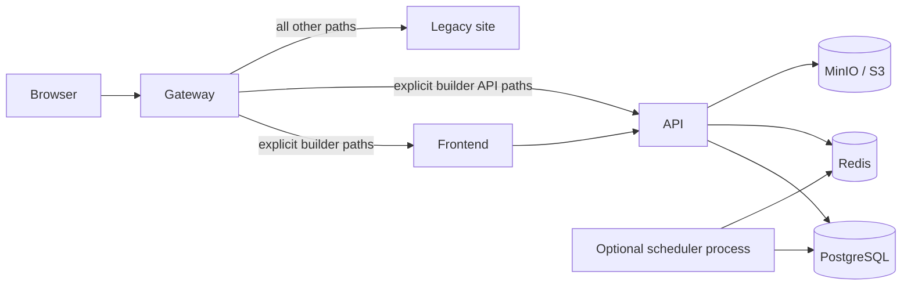

# Architecture

## Scope

The Page Builder is an independently deployable bounded context. It owns draft
editing, publishing workflows, page-builder metadata, and media references. It
does not own legacy rendering, identity, or the existing site's route map until
explicit integration contracts are approved.

The opt-in `gateway` Compose profile implements this boundary. It is the only
Page Builder service attached to the external legacy-origin network; all Page
Builder services retain their private bridge. The selected local legacy
upstream is resolved by Docker DNS as `site-frontend-1:80` on `site_default`.

## Containers

- **Frontend** serves the editor and public builder UI on port `5173`; Vite and
  BrowserRouter share `/page-builder/` as their integrated base path.
- **Backend API** exposes health and application APIs on port `8000`.
- **PostgreSQL** is the source of truth for pages, revisions, publication
  state, permissions, and job metadata.
- **Redis** supports cache, rate limiting, and resilient coordination.
- **MinIO** supplies a local S3-compatible media store. Production should use a
  managed or equivalently durable object store.
- **Scheduler** reuses the backend image and is disabled behind a Compose
  profile. The backend exposes no separate worker entrypoint.

## Request and publication flow

1. The user authenticates through the agreed identity adapter.
2. The frontend loads a page and revision through versioned API endpoints.
3. Draft updates use optimistic concurrency; stale writers receive a conflict
   rather than silently overwriting newer content.
4. Publish requests record an immutable revision and an auditable job.
5. The scheduler claims due publication jobs from PostgreSQL. Retries must be
   idempotent.
6. Public reads resolve only published revisions and should never expose draft
   data.

Batch publishing is an administrative operation with authorization,
idempotency keys, bounded batch sizes, and per-item results.

## Data and consistency

- PostgreSQL transactions protect page/revision state transitions.
- Media bytes live in object storage; PostgreSQL stores immutable object keys,
  checksums, metadata, and ownership.
- Redis is disposable. Losing it may delay work or reduce cache performance but
  must not lose the source-of-truth publication state.
- Scheduled jobs use durable PostgreSQL state and retry semantics. Handlers
  must make duplicate execution harmless.
- Backup recovery points pair a PostgreSQL snapshot with an object-store
  inventory from a compatible time.

## Safety boundaries

- Feature flags default off and are evaluated server-side for privileged or
  mutating capabilities.
- The gateway owns only `/page-builder/` and `/api/page-builder/v1`; root
  `/api`, `/assets`, and every other ordinary URL remain legacy-owned.
- Legacy remains the default route. A missing legacy upstream yields `503`,
  never an automatic failover to the builder.
- The gateway route flag and application flag are separate controls. Disable
  ingress first during an incident, then stop background mutation.
- Migrations follow expand/migrate/contract so the previous application
  version can run during rollback.
- Secrets are injected at runtime and never stored in frontend build output,
  images, logs, or repository files.

## Scaling and availability

API and frontend instances are stateless and horizontally scalable. Exactly one
logical scheduler should claim each due job via the backend's PostgreSQL
advisory lock; replicas may run only while that leadership behavior remains
tested.

The initial public performance objective is a measured 500 requests/second,
not an unverified capacity claim. Run `infra/load/k6/public.js` in an approved
environment and retain the evidence.

## Observability contract

Every component should emit structured logs with request or job correlation
IDs. At minimum, track request rate, latency, error rate, saturation, queue
depth/age, publish duration/failures, database pool pressure, Redis errors,
object-store errors, and scheduler lag. Alert on user impact and exhausted
capacity rather than individual transient failures.

## Open integration decisions

Before production, finalize identity and role mapping, API path/versioning,
legacy route ownership, canonical URLs, cache invalidation, public rendering
ownership, media scanning/CDN behavior, queue implementation, retention, and
recovery objectives.
